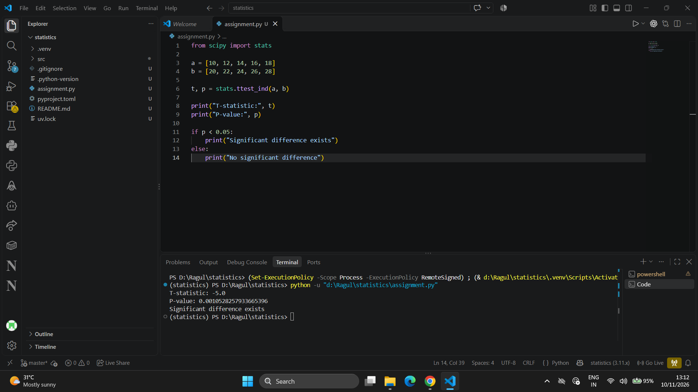
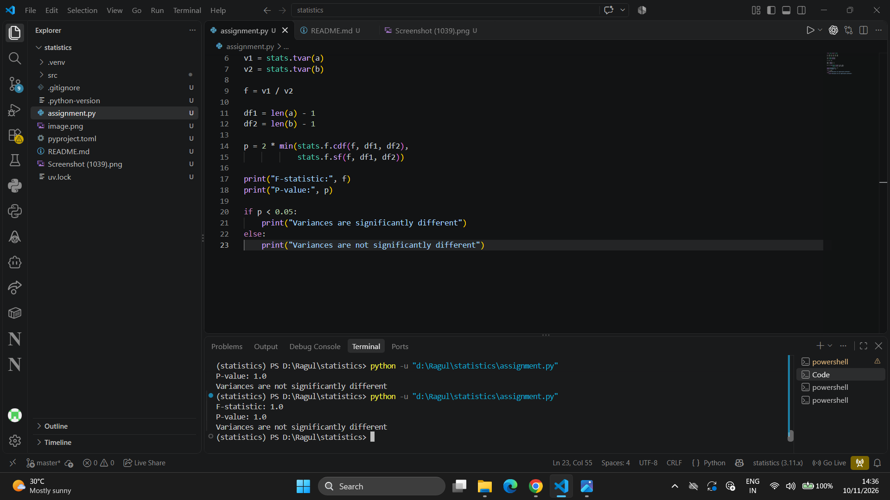
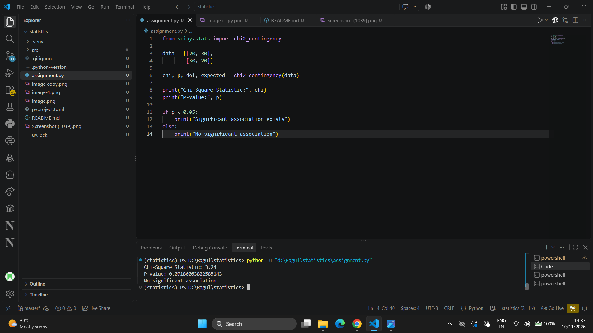
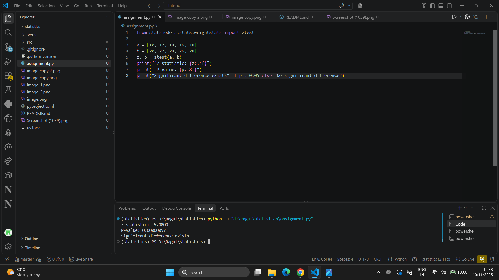
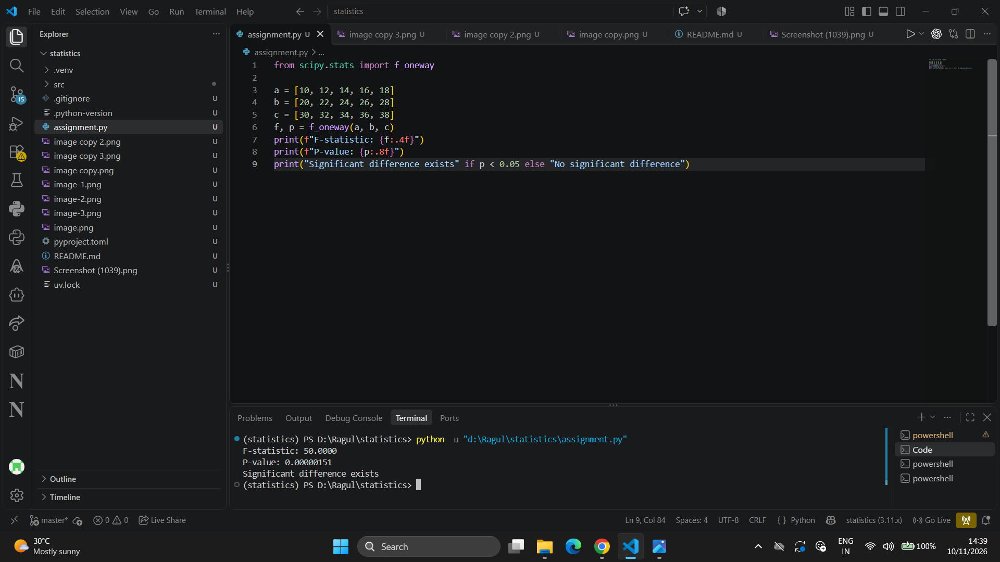
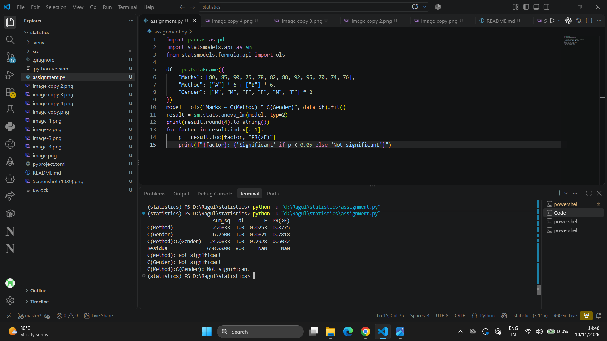
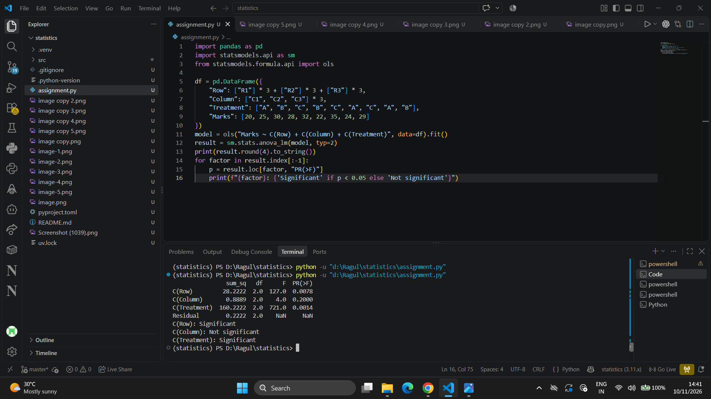
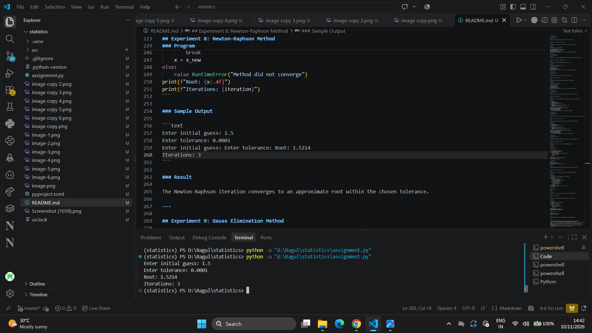
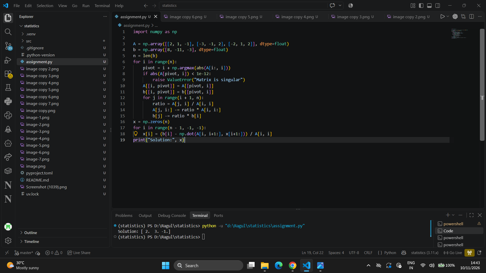
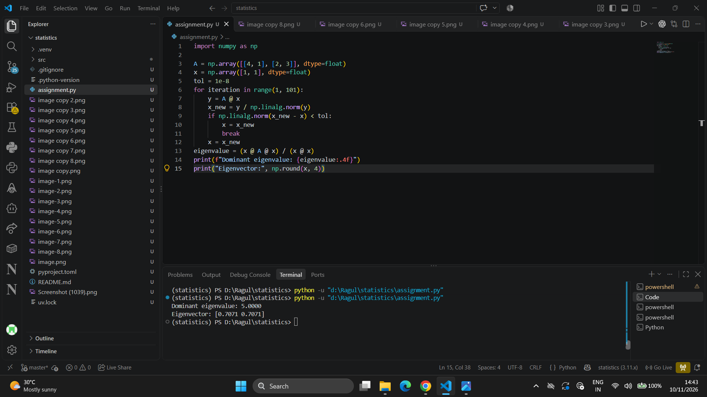

## Experiment 1: Independent Samples t-Test
### Aim

To perform an independent two-sample t-test and determine whether the sample means differ significantly.

### Program

```python
from scipy import stats

a = [10, 12, 14, 16, 18]
b = [20, 22, 24, 26, 28]
t, p = stats.ttest_ind(a, b)
print(f"T-statistic: {t:.4f}")
print(f"P-value: {p:.6f}")
print("Significant difference exists" if p < 0.05 else "No significant difference")
```

### Sample Output



### Result

The t-test compares the two independent sample means at the 5% significance level.

---

## Experiment 2: F-Test for Two Variances

### Aim

To compare the variances of two independent datasets using an F-test.

### Program

```python
from scipy import stats

a = [10, 12, 14, 16, 18]
b = [11, 13, 15, 17, 19]
v1, v2 = stats.tvar(a), stats.tvar(b)
f = v1 / v2
df1, df2 = len(a) - 1, len(b) - 1
p = min(1.0, 2 * min(stats.f.cdf(f, df1, df2), stats.f.sf(f, df1, df2)))
print(f"F-statistic: {f:.4f}")
print(f"P-value: {p:.6f}")
print("Variances are significantly different" if p < 0.05 else "Variances are not significantly different")
```

### Sample Output



### Result

The two-sided F-test compares sample variances at the 5% significance level.

---

## Experiment 3: Chi-Square Test for Independence

### Aim

To test whether two categorical variables are associated using a contingency table.

### Program

```python
from scipy.stats import chi2_contingency

data = [[20, 30], [30, 20]]
chi, p, dof, expected = chi2_contingency(data)
print(f"Chi-Square statistic: {chi:.4f}")
print(f"P-value: {p:.6f}")
print(f"Degrees of freedom: {dof}")
print("Significant association exists" if p < 0.05 else "No significant association")
```

### Sample Output



### Result

The chi-square test evaluates independence between the categorical variables at the 5% significance level.

---

## Experiment 4: Z-Test for Two Independent Means

### Aim

To test whether two independent sample means differ using a Z-test.

### Program

```python
from statsmodels.stats.weightstats import ztest

a = [10, 12, 14, 16, 18]
b = [20, 22, 24, 26, 28]
z, p = ztest(a, b)
print(f"Z-statistic: {z:.4f}")
print(f"P-value: {p:.8f}")
print("Significant difference exists" if p < 0.05 else "No significant difference")
```

### Sample Output



### Result

The Z-test compares the two sample means at the 5% significance level.

---

## Experiment 5: One-Way ANOVA

### Aim

To determine whether the means of three independent groups differ significantly.

### Program

```python
from scipy.stats import f_oneway

a = [10, 12, 14, 16, 18]
b = [20, 22, 24, 26, 28]
c = [30, 32, 34, 36, 38]
f, p = f_oneway(a, b, c)
print(f"F-statistic: {f:.4f}")
print(f"P-value: {p:.8f}")
print("Significant difference exists" if p < 0.05 else "No significant difference")
```

### Sample Output



### Result

One-way ANOVA tests whether at least one group mean differs at the 5% significance level.

---

## Experiment 6: Two-Way ANOVA

### Aim

To analyze the effects of two categorical factors and their interaction on a numerical response.

### Program

```python
import pandas as pd
import statsmodels.api as sm
from statsmodels.formula.api import ols

df = pd.DataFrame({
    "Marks": [80, 85, 90, 75, 78, 82, 88, 92, 95, 70, 74, 76],
    "Method": ["A"] * 6 + ["B"] * 6,
    "Gender": ["M", "M", "F", "F", "M", "F"] * 2
})
model = ols("Marks ~ C(Method) * C(Gender)", data=df).fit()
result = sm.stats.anova_lm(model, typ=2)
print(result.round(4).to_string())
for factor in result.index[:-1]:
    p = result.loc[factor, "PR(>F)"]
    print(f"{factor}: {'Significant' if p < 0.05 else 'Not significant'}")
```

### Sample Output



### Result

The two-way ANOVA tests the main effects of Method and Gender and their interaction at the 5% significance level.

---

## Experiment 7: Latin Square Design ANOVA

### Aim

To analyze the effects of treatments while controlling for row and column blocking factors.

### Program

```python
import pandas as pd
import statsmodels.api as sm
from statsmodels.formula.api import ols

df = pd.DataFrame({
    "Row": ["R1"] * 3 + ["R2"] * 3 + ["R3"] * 3,
    "Column": ["C1", "C2", "C3"] * 3,
    "Treatment": ["A", "B", "C", "B", "C", "A", "C", "A", "B"],
    "Marks": [20, 25, 30, 28, 32, 22, 35, 24, 29]
})
model = ols("Marks ~ C(Row) + C(Column) + C(Treatment)", data=df).fit()
result = sm.stats.anova_lm(model, typ=2)
print(result.round(4).to_string())
for factor in result.index[:-1]:
    p = result.loc[factor, "PR(>F)"]
    print(f"{factor}: {'Significant' if p < 0.05 else 'Not significant'}")
```

### Sample Output



### Result

Latin Square ANOVA evaluates treatment, row and column effects at the 5% significance level.

---

## Experiment 8: Newton-Raphson Method

### Aim

To approximate a root of f(x) = x³ − x − 2 using Newton-Raphson iteration.

### Program

```python
def f(x):
    return x**3 - x - 2

def df(x):
    return 3*x**2 - 1

x = float(input("Enter initial guess: "))
tol = float(input("Enter tolerance: "))
for iteration in range(1, 101):
    if abs(df(x)) < 1e-12:
        raise ValueError("Derivative is too close to zero")
    x_new = x - f(x) / df(x)
    if abs(x_new - x) < tol:
        x = x_new
        break
    x = x_new
else:
    raise RuntimeError("Method did not converge")
print(f"Root: {x:.4f}")
print(f"Iterations: {iteration}")
```

### Sample Output



### Result

The Newton-Raphson iteration converges to an approximate root within the chosen tolerance.

---

## Experiment 9: Gauss Elimination Method

### Aim

To solve a system of linear equations using forward elimination and back substitution.

### Program

```python
import numpy as np

A = np.array([[2, 1, -1], [-3, -1, 2], [-2, 1, 2]], dtype=float)
b = np.array([8, -11, -3], dtype=float)
n = len(b)
for i in range(n):
    pivot = i + np.argmax(abs(A[i:, i]))
    if abs(A[pivot, i]) < 1e-12:
        raise ValueError("Matrix is singular")
    A[[i, pivot]] = A[[pivot, i]]
    b[[i, pivot]] = b[[pivot, i]]
    for j in range(i + 1, n):
        ratio = A[j, i] / A[i, i]
        A[j, i:] -= ratio * A[i, i:]
        b[j] -= ratio * b[i]
x = np.zeros(n)
for i in range(n - 1, -1, -1):
    x[i] = (b[i] - np.dot(A[i, i+1:], x[i+1:])) / A[i, i]
print("Solution:", x)
```

### Sample Output



### Result

Gaussian elimination with partial pivoting gives the solution to the linear system.

---

## Experiment 10: Power Method

### Aim

To find the dominant eigenvalue and corresponding eigenvector of a square matrix.

### Program

```python
import numpy as np

A = np.array([[4, 1], [2, 3]], dtype=float)
x = np.array([1, 1], dtype=float)
tol = 1e-8
for iteration in range(1, 101):
    y = A @ x
    x_new = y / np.linalg.norm(y)
    if np.linalg.norm(x_new - x) < tol:
        x = x_new
        break
    x = x_new
eigenvalue = (x @ A @ x) / (x @ x)
print(f"Dominant eigenvalue: {eigenvalue:.4f}")
print("Eigenvector:", np.round(x, 4))
```

### Sample Output



### Result

The power method estimates the dominant eigenvalue and its normalized eigenvector.

---

## Notes

- The sample inputs and outputs are demonstrations, not values supplied by the assignment PDF.
- The F-test assumes independent samples drawn from normally distributed populations.
- The t-test shown uses the standard equal-variance independent-samples test; use Welch’s test if equal variances cannot be assumed.
- ANOVA results depend on model assumptions, including independence and appropriate residual behavior.
- The Z-test is presented as requested in the assignment; for small samples with unknown population variance, a t-test is often more appropriate.
- The Newton-Raphson program uses an example function and prompts for the initial guess and tolerance.
- Gaussian elimination uses partial pivoting for better numerical stability.

## Conclusion

All ten Assignment I experiments demonstrate fundamental statistical and numerical methods using Python.
